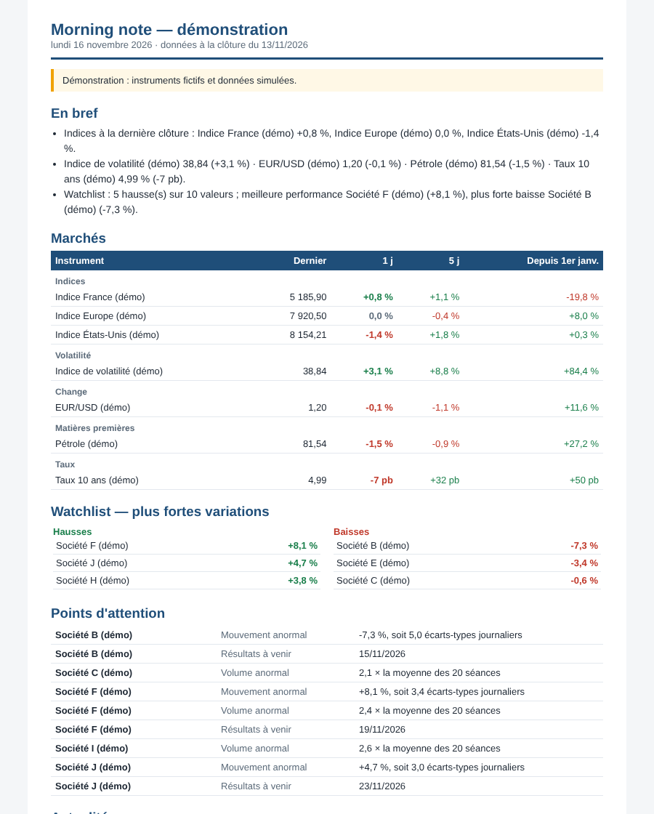

# Morning note automatisée

**Chaque matin avant l'ouverture, une note de marché prête à envoyer aux clients, générée sur une watchlist d'actions que l'on choisit.**

Sur un desk actions, la morning note se prépare en général à la main entre 6h30 et 8h. Ce projet automatise la partie factuelle : il récupère les données, calcule les variations, repère ce qui sort de l'ordinaire et met le tout en page.
Le sales peut alors consacrer son temps au commentaire.



## Contenu de la note

1. **En bref** : résumé factuel en trois phrases (indices, change, pétrole, taux, bilan de la watchlist).
2. **Marchés** : indices européens, américains et asiatiques, VIX, EUR/USD, Brent, or, taux US 10 ans. Variations sur 1 jour, 5 jours et depuis le 1er janvier ; pour les taux, en points de base.
3. **Plus fortes variations** de la watchlist, en hausse et en baisse.
4. **Points d'attention**, détectés automatiquement : mouvements anormaux, volumes anormaux, plus hauts et plus bas sur 52 semaines, RSI extrême, résultats dans les 10 jours.
5. **Actualités** de chaque valeur (titres et liens Yahoo Finance).
6. **Tableau complet** de la watchlist.

Formats produits : **HTML** prêt pour un e-mail (styles intégrés, compatible Outlook et Gmail) et **Markdown** pour un chat.

## Utilisation

```bash
git clone https://github.com/Valentin-Knarov/automated-morning-note.git
cd automated-morning-note
pip install -r requirements.txt

python -m morning_note                     # données réelles Yahoo Finance
python -m morning_note --demo              # instruments fictifs, sans connexion
python -m morning_note --commentary "Ouverture attendue en baisse après…"
python -m morning_note --send              # envoi par e-mail (voir plus bas)
```

La note est écrite dans `output/morning_AAAA-MM-JJ.html` et `.md`.

**Choisir ses valeurs** : modifie [`watchlist.toml`](watchlist.toml). Pour chaque valeur, il suffit d'un ticker Yahoo (ex. `CAP.PA`) et d'un libellé. Les seuils d'alerte se règlent dans le même fichier.

## Règles de détection

Notations : $P_t$ cours de clôture de la dernière séance ; $r_t = P_t / P_{t-1} - 1$ son rendement ; $\sigma_{20}$ écart-type des rendements journaliers sur les 20 séances précédentes ; $N_t$ volume de la dernière séance ; $\bar N_{20}$ volume moyen des 20 séances précédentes.

| Alerte | Condition (seuils par défaut, modifiables) |
|---|---|
| Mouvement anormal | $\lvert r_t \rvert / \sigma_{20} \geq 2$ : le mouvement dépasse 2 écarts-types habituels du titre |
| Volume anormal | $N_t / \bar N_{20} \geq 2$ |
| Plus haut / plus bas 52 semaines | $P_t$ au-dessus du plus haut, ou sous le plus bas, des 252 séances précédentes |
| RSI extrême | RSI 14 j ≥ 75 (surachat) ou ≤ 25 (survente) |
| Résultats à venir | date de publication dans les 10 jours (calendrier Yahoo) |

RSI de Wilder : $\text{RSI} = 100 - \dfrac{100}{1 + RS}$, où $RS$ est le rapport entre la moyenne exponentielle des hausses et celle des baisses sur 14 séances.

Normaliser le mouvement par la volatilité propre au titre évite deux biais : signaler chaque jour une small cap volatile qui fait +3 %, et passer à côté d'un +2 % inhabituel sur une valeur défensive.

## Automatiser l'envoi

### Option 1 : GitHub Actions (aucune machine à laisser allumée)
Le fichier [`.github/workflows/morning.yml`](.github/workflows/morning.yml) génère la note **chaque jour ouvré à 7h15** (heure de Paris en hiver).
Pour activer l'envoi par e-mail, ajoute ces secrets dans *Settings → Secrets and variables → Actions* : `SMTP_HOST`, `SMTP_PORT`, `SMTP_USER`, `SMTP_PASSWORD`, `MAIL_TO`.
Pour Gmail : `smtp.gmail.com`, port `587` et un *mot de passe d'application*.
Sans secrets, la note reste téléchargeable dans l'onglet *Actions*, comme artefact du dernier lancement.

### Option 2 : sur son ordinateur
- macOS / Linux : `crontab -e`, puis `15 7 * * 1-5 cd /chemin/automated-morning-note && python3 -m morning_note --send`
- Windows : Planificateur de tâches → *Créer une tâche de base* → du lundi au vendredi à 7h15 → programme `python`, arguments `-m morning_note --send`, dossier de démarrage = celui du projet.

### Option 3 : tâche planifiée Claude, pour le commentaire
Le pipeline donne les faits. Le *pourquoi* des mouvements demande de lire l'actualité.
[`docs/tache_planifiee_claude.md`](docs/tache_planifiee_claude.md) fournit un prompt de tâche planifiée Claude qui rédige ce commentaire chaque matin, avec ses sources. Ce commentaire peut ensuite être injecté dans la note via `--commentary`.

## Structure du code

```
morning_note/
├── config.py     # lecture de watchlist.toml (+ univers fictif du mode démo)
├── data.py       # Yahoo Finance : cours, actualités, dates de résultats ; simulation
├── analytics.py  # variations, alertes, résumé factuel
├── fmt.py        # formats français (virgule, espaces, %)
├── render.py     # note HTML (e-mail) et Markdown
├── send.py       # envoi SMTP (identifiants en variables d'environnement)
└── __main__.py   # ligne de commande
tests/            # pytest
```

## Limites

- **Données Yahoo Finance** : gratuites, parfois en retard ou incomplètes (actualités et dates de résultats en particulier). Un desk utiliserait Bloomberg ou Refinitiv.
- **Pas de futures avant l'ouverture** : la note s'appuie sur les clôtures de la veille. Les marchés asiatiques et le change donnent la tendance de la nuit.
- **Pas de commentaire automatique** : choix délibéré, le pipeline reste factuel (voir l'option 3).

---

*Projet personnel de Valentin Knarov (emlyon business school, PGE & licence de mathématiques à Lyon 1).
Document d'information : ne constitue pas un conseil en investissement.*
